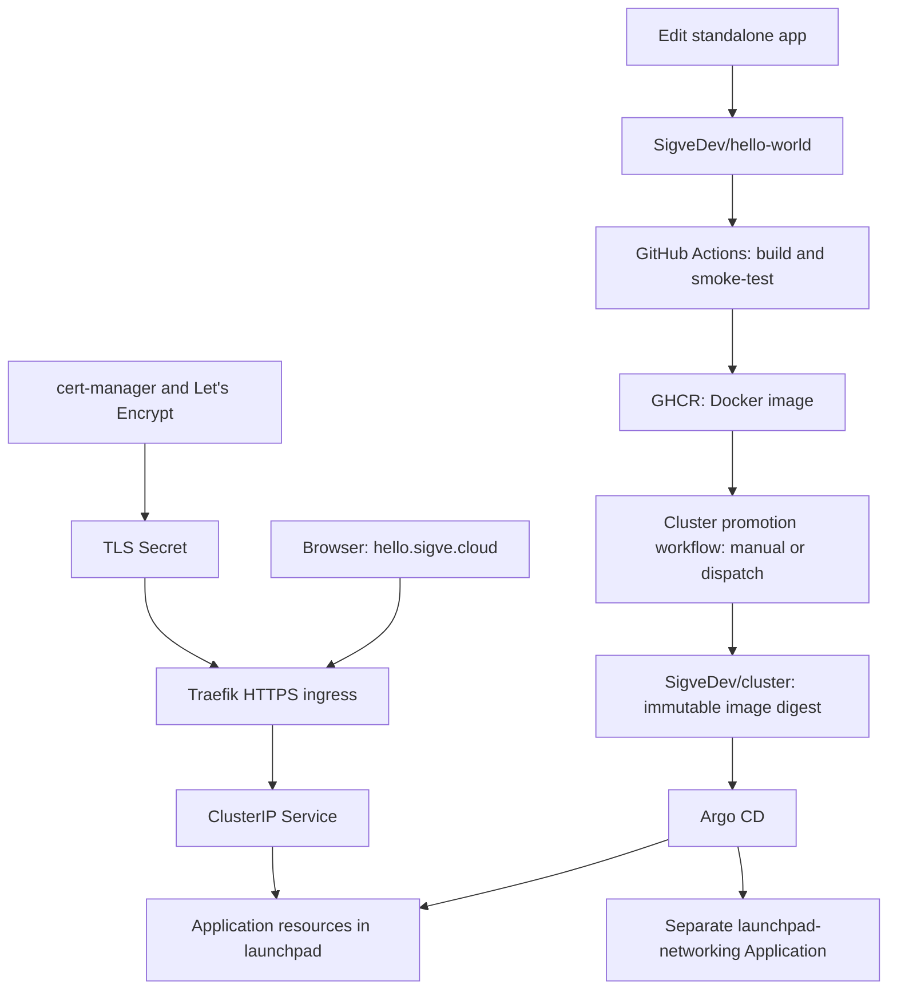

# sigve.cloud: cloud setup and repository map

A personal Kubernetes cloud on a Hostinger VPS, built to learn cluster administration and deploy real applications from GitHub.

The server runs **Ubuntu Server 26.04 LTS and K3s**. Headlamp provides a Kubernetes management interface, Argo CD provides GitOps deployment, Traefik routes application subdomains, and cert-manager requests HTTPS certificates from Let's Encrypt.

The first application is a welcome page at **https://hello.sigve.cloud**. GitHub Actions builds its Docker image, publishes it to GitHub Container Registry (GHCR), and requests a release promotion in the separate cluster repository. A cluster workflow records the immutable image digest in Git, and Argo CD deploys the image described by that commit.

**Infrastructure repository:** https://github.com/SigveDev/cluster

**Application repository:** https://github.com/SigveDev/hello-world

**Local projects:** `E:\Github\cluster` (infrastructure), `E:\Github\hello-world` (app), `E:\Github\sd-cloud` (documentation workspace)

**Documentation baseline:** 29 October 2026

This README describes the intended configuration and the setup procedure developed during the project. The VPS is not connected to this workspace for remote administration. See the status table below and the [setup history](docs/SETUP-HISTORY.md) for what was reported working versus what was only supplied as instructions. A documented URL is not proof that its live service is healthy.

## Read this first

| Task | Guide |
| --- | --- |
| Deploy another Vite + TypeScript app | [New app deployment guide](https://github.com/SigveDev/cluster/blob/main/docs/DEPLOY-NEW-APPS.md) |
| Configure Argo read access and cross-repo dispatch tokens | [GitHub token setup](docs/GITHUB-TOKENS.md) |
| Keep container images private | [Private GHCR access](docs/PRIVATE-REGISTRY.md) |
| Deploy the first application | [Hello-world deployment walkthrough](docs/DEPLOY-HELLO-WORLD.md) |
| Understand the infrastructure and learning milestones | [Setup plan](SETUP-PLAN.md) |
| Rebuild Ubuntu access and install K3s | [VPS bootstrap](docs/VPS-BOOTSTRAP.md) |
| Install Headlamp, Argo CD, ingress, and certificates | [GUI setup](docs/GUI-SETUP.md) |
| Review decisions, changes, and reported setup progress | [Setup history](docs/SETUP-HISTORY.md) |

Public VPS/client addresses and actual credentials are intentionally excluded. `<VPS_PUBLIC_IP>`, `<CLIENT_PUBLIC_IP_CIDR>`, and similar values must be supplied locally. Port numbers, resource limits, namespaces, domain names, and software versions remain documented. No passwords, SSH private keys, kubeconfigs, service-account tokens, or GHCR credentials belong in Git.

## Current decisions and reported status

| Component | Configuration | Evidence/status |
| --- | --- | --- |
| Provider | Hostinger VPS | User supplied |
| OS | Ubuntu 26.04.1 LTS, x86_64 | Shown in server output |
| Capacity | 2 vCPUs, approximately 8 GB RAM, 96 GB root filesystem | Shown in server output |
| Swap | Initially disabled | Shown in server output |
| Administrator | `sigve`, sudo, SSH key authentication | Guided and user proceeded after testing |
| SSH alias | `sigve-cloud` | Configured in the walkthrough; filename correction supplied |
| Host firewall | UFW disabled | Shown in server output |
| Provider firewall | Restricted SSH; public TCP 80/443; default deny | Configuration instructions supplied; attachment/rules not independently inspected |
| Kubernetes | Single-server K3s, node name `k3s01` | User reported K3s was up; exact live version not independently read |
| K3s installation pin | `v1.36.5+k3s1` | Version used in installation instructions |
| Ingress | K3s-bundled Traefik / ServiceLB | Default selected; live readiness not independently inspected |
| Certificates | cert-manager and staging/production ClusterIssuers | Installation instructions supplied |
| Management | Headlamp at `cluster.sigve.cloud` | Installation and login instructions supplied; final browser login not confirmed |
| Deployments | Argo CD at `argo.sigve.cloud` | Installation and login instructions supplied; final browser login not confirmed |
| Application namespace | `launchpad` | Selected; replaces the unused proposed name `learning` |
| Welcome application | Docker build, GHCR, Kubernetes manifests, Argo bootstrap | User reported the HTTPS app working after Argo deployment and DNS troubleshooting; live state not independently inspected |

## Architecture



The app repo owns source code and image publication. This repo owns desired deployment versions, Argo definitions, ingress, certificates, and namespace network policy. The app workflow has no kubeconfig or direct access to the VPS. Manual promotion works without a cross-repository token; automatic dispatch requires an explicitly scoped credential.

One VPS hosts both the control plane and workloads. Replicas do not provide server-level availability. SQLite and local-path data are node-local; persistent data needs external backups.

## Why K3s, rather than OpenShift or Compose?

The original request considered OpenShift. This server is smaller than the documented single-node OpenShift requirements, and Hostinger documents that custom VPS OS images are not supported. Standard OpenShift provisioning uses CoreOS. OpenShift is a potential later lab on compatible infrastructure.

Docker Compose was initially considered for simple hosting, then replaced when Kubernetes learning became the main goal. K3s supplies standard Kubernetes APIs with a manageable footprint on one VPS.

K3s uses **containerd** on the server. It does not need Docker Engine installed there. Docker is used by GitHub-hosted build runners to create application images; Kubernetes pulls those OCI images using containerd.

## Domain and routing layout

| Hostname | Destination | Kubernetes namespace |
| --- | --- | --- |
| `cluster.sigve.cloud` | Headlamp | `headlamp` |
| `argo.sigve.cloud` | Argo CD | `argocd` |
| `hello.sigve.cloud` | Welcome application | `launchpad` |

Create A records named `cluster`, `argo`, and `hello`, all pointing to `<VPS_PUBLIC_IP>`. A wildcard A record can supply otherwise undefined subdomains instead. Preserve mail and verification records. Registering the domain at Hostinger does not prove its authoritative nameservers are there; edit records at the actual DNS provider.

Add AAAA records only after IPv6 routing and firewalling have been configured end to end. A stale AAAA record can send browsers and ACME validation to the wrong server even when the A record is correct.

Wildcard DNS only resolves names. It does not create Kubernetes Services, routes, or certificates. This project initially uses individual certificates with HTTP-01 validation. Wildcard certificates require automated DNS-01 and a compatible DNS-provider integration.

### Traffic flow

1. DNS resolves a hostname to the VPS.
2. Hostinger's firewall permits public TCP 80/443.
3. K3s ServiceLB exposes Traefik on those ports.
4. Traefik selects an Ingress by hostname.
5. Traefik terminates HTTPS using the referenced TLS Secret.
6. A ClusterIP Service forwards application traffic to ready Pods.

There is no host-installed Nginx proxy. Nginx runs inside the welcome application's container as the web server. The current GUI and app routes use the HTTPS entrypoint explicitly; an ordinary HTTP-to-HTTPS redirect is not configured by these manifests. Port 80 remains available for cert-manager's temporary HTTP-01 solver routes.

## Repository layout

```text
E:\Github\
  hello-world/                         # Standalone app: github.com/SigveDev/hello-world
    Dockerfile
    .dockerignore
    site/index.html
    site/healthz
    .github/workflows/hello-world.yml
    README.md
  cluster/                       # Infrastructure: github.com/SigveDev/cluster
    README.md
    SETUP-PLAN.md
    argocd/bootstrap.yaml
    apps/hello-world/             # Kustomize app manifests; no application source
    networking/launchpad/         # Default-deny and explicit traffic allowances
    platform/                    # Bootstrap Helm values, GUI ingress, issuer template
    infra/k3s/config.yaml         # Non-secret server configuration
    .github/workflows/
      validate.yml
      promote-hello-world.yml
    docs/
  sd-cloud/                      # Original documentation workspace; no app code
    README.md
    SETUP-PLAN.md
    docs/
```

Both real projects are independent Git repositories, initialized on `main`. The application remote is the user-selected new `SigveDev/hello-world`. Both GitHub remotes were created and verified as private empty repositories. No commit or push has been performed here. The pre-existing SigveDev/cloud remote was left untouched.

The VPS working directory `~/sd-cloud-platform`, used for Helm values and GUI setup, is separate from these Windows checkouts. Those server files have not been copied back or independently inspected here. Their reproducible, credential-free definitions are in the GUI guide.

## Host setup

The [bootstrap guide](docs/VPS-BOOTSTRAP.md) contains the commands for the following sequence:

1. Install Hostinger's plain Ubuntu 26.04 template.
2. Connect initially as root using the provider's connection details.
3. Verify the SSH host key through Hostinger Web Console, especially after a reinstall.
4. Inspect OS, CPU, memory, disk, architecture, and swap.
5. Update packages and create the `sigve` sudo administrator.
6. Generate an Ed25519 SSH key on Windows, copy only its public key to the server, and test key-only login.
7. Create the Windows SSH alias `sigve-cloud` in `.ssh/config`, without a `.txt` extension.
8. Disable root SSH login, password authentication, and keyboard-interactive authentication after confirming the new account works.
9. Configure and attach the Hostinger firewall, test a new connection, and retain Web Console recovery access.
10. Reboot and reconnect.
11. Disable UFW for the selected provider-firewall-based setup and install pinned K3s with Secret encryption enabled.
12. Inspect node, system Pods, and encryption status.

### Network access

| Connection | Exposure |
| --- | --- |
| SSH, TCP 22 | Trusted client addresses or VPN |
| HTTP, TCP 80 | Public; needed for HTTP-01 |
| HTTPS, TCP 443 | Public application endpoints |
| Kubernetes API, TCP 6443 | Restricted; use an SSH tunnel or VPN for remote administration |
| NodePort ranges, databases, kubelet, datastore | Not generally exposed to the internet |
| Node overlay traffic | Private/VPN node connectivity only if expanding the cluster |

Disabling UFW does not configure Hostinger's firewall. The provider rules must actually be attached to the VPS. The service definitions here use ClusterIP so they do not intentionally publish application NodePorts. For multi-node networking, review backend-specific requirements before opening any node ports; never expose VXLAN broadly to the internet.

## Kubernetes configuration

The installation walkthrough used this `/etc/rancher/k3s/config.yaml`:

```yaml
node-name: k3s01
write-kubeconfig-mode: "0600"
secrets-encryption: true
```

It retains the packaged components and the default single-server SQLite datastore. The kubeconfig at `/etc/rancher/k3s/k3s.yaml` is administrative and remains protected. Use `sudo kubectl` initially rather than making it world-readable.

Bundled components include Traefik, ServiceLB, CoreDNS, Flannel, local-path storage, and metrics-server. Inspect what the selected K3s release actually installs before adding duplicates. Use HelmChartConfig for supported packaged-Traefik customization instead of editing files K3s regenerates.

### Namespace responsibilities

| Namespace | Purpose |
| --- | --- |
| `kube-system` | K3s packaged cluster services |
| `cert-manager` | Certificate controllers |
| `headlamp` | Headlamp backend and human-login service account |
| `argocd` | Argo CD and its configuration |
| `launchpad` | First applications and experiments |

The originally proposed `learning` namespace was not used; `launchpad` is the chosen name. Kubernetes cannot rename namespaces in place. If an old namespace unexpectedly exists, inspect it before any deletion or migration.

## GUI installation and authentication

The [GUI guide](docs/GUI-SETUP.md) provides the full Helm values, issuers, RBAC, and Ingress definitions. The pinned versions used in that guide are:

| Package | Pin |
| --- | --- |
| Helm CLI | `v4.3.1` |
| cert-manager chart | `v1.21.3` |
| Headlamp chart | `0.46.0` |
| Argo CD chart | `10.11.6`, application `v3.5.6` |

These pins were checked while preparing the guide. Review current compatibility and security updates before rebuilding at a later date.

### Headlamp

Headlamp is exposed at `https://cluster.sigve.cloud`. Browser users must authenticate; `unsafeUseServiceAccountToken` stays disabled. The chart's default cluster-admin binding for the backend service account is disabled.

The human account is `headlamp/sigve-ui`. Its bindings grant the built-in `view` role across namespaces and the built-in `admin` role inside `launchpad`. Some cluster views and actions are intentionally forbidden; `view` does not grant all cluster-scoped access or Secret contents. Management rights inside `launchpad` include sensitive resources in that namespace.

Generate a temporary login token on the VPS:

```bash
sudo kubectl -n headlamp create token sigve-ui --duration=1h
```

Paste it only into the trusted Headlamp HTTPS site. Tokens are credentials, not repository content. A future OIDC setup can replace this manual login flow.

### Argo CD

Argo CD is exposed at `https://argo.sigve.cloud`. Its initial admin password is obtained locally on the VPS and changed after first login. Delete `argocd-initial-admin-secret` only after confirming the replacement password works. The password is not recorded here.

Anonymous access is disabled. Dex and notifications are disabled in the initial small-server installation. Traefik terminates public TLS, and Argo's `server.insecure: true` enables internal HTTP transport; it does not disable login. The backend is a ClusterIP Service.

The first `hello-world` Argo Application uses a scoped AppProject named `launchpad`, with one source repository, one destination namespace, and an allowlist of the application and NetworkPolicy resource kinds. It cannot deploy cluster-scoped resources. Namespace creation is an administrator bootstrap action.

## Certificates

Two ClusterIssuers are documented:

- `letsencrypt-staging`: validates the configuration using untrusted test certificates.
- `letsencrypt-prod`: issues trusted certificates after staging works.

Both use HTTP-01 with `ingressClassName: traefik`. The GUI procedure first proves staging issuance, then changes the ingress issuer annotations to production. Do not enter credentials while a browser reports an untrusted certificate.

The hello-world app uses an explicit namespaced `Certificate`, referencing `letsencrypt-prod`, and an Ingress referencing its TLS Secret. cert-manager owns ACME Orders/Challenges and the resulting Secret. There is no Certbot installation on the host.

Check the certificate and public endpoint after sync. Workload health alone does not prove DNS or TLS works:

```bash
sudo kubectl -n launchpad get certificate
sudo kubectl -n launchpad describe certificate hello-world-tls
curl --fail --head https://hello.sigve.cloud
```

## Welcome application

The standalone source is in **`E:\Github\hello-world`**, repository **https://github.com/SigveDev/hello-world**. Its root contains the Dockerfile, `site/` files, and build workflow. See that project's README for local previews and releases.

The app has no framework dependencies, external assets, or required runtime secrets. Nginx serves the baked-in page and `/healthz`. The immutable upstream base is unprivileged, using container port 8080 and UID/GID 101. The cluster Deployment applies a read-only root filesystem, dropped capabilities, no privilege escalation, no service-account token, and a small writable `/tmp`.

The Deployment in this repository requests 50 millicores and 32 MiB memory, with limits of 250 millicores and 128 MiB. Startup/readiness/liveness probes check `/healthz`. One replica is appropriate for the first release. The app repo contains no Kubernetes or Argo deployment manifests.

## GitHub Actions: two repositories and release promotion

### Application repository: hello-world

`.github/workflows/hello-world.yml` builds the root Dockerfile and smoke-tests `/healthz` and the page under deployment-like restrictions. Pull requests only verify. Trusted `main` builds publish `ghcr.io/sigvedev/hello-world` for `linux/amd64`, with source-commit and `latest` tags. The workflow summary reports the immutable digest.

The publish job uses `GITHUB_TOKEN` with `contents: read` and `packages: write`. It cannot update another Git repository using that built-in token. There are no deployment manifests or bot deployment commits in the app repo.

### Infrastructure repository: cluster

`.github/workflows/promote-hello-world.yml` accepts an image digest and optional app source commit through workflow dispatch. It validates both formats, authenticates to GHCR and checks the fixed private image exists, edits only `apps/hello-world/deployment.yaml`, and commits that digest to this repo's `main`. It uses this repo's own `GITHUB_TOKEN` with `contents: write` and `packages: read`; package Actions access must grant this repo Read permission.

For the first release, manually run **Promote hello-world** in this repo's Actions tab using the digest from the app workflow. The package can remain private. Grant cluster Read access under the package's Manage Actions access and create the node image-pull Secret before deployment.

For automatic handoff, store a fine-grained token as **`CLUSTER_REPO_TOKEN` in the hello-world repo's Actions secrets**. Select only `SigveDev/cluster`, with **Actions: write**; metadata access is automatic. This token requests a workflow dispatch in cluster, not a direct Git write. It can execute cluster workflows, so restrict who can modify the app workflow and use an expiry/rotation plan. A GitHub App installation token is an alternative.

Without this secret, app publication still succeeds and clearly reports that promotion is manual. With it, the app workflow requests promotion only when its source has not been superseded on main. Dispatch acceptance is not proof that the separate cluster workflow completed successfully; check both runs. Branch protection must permit the cluster workflow's bot commit, or adapt promotion to a reviewed pull request instead.

`.github/workflows/validate.yml` renders both the app and networking Kustomize roots for pushes and PRs. GitHub generally suppresses new Actions runs from bot pushes made with `GITHUB_TOKEN`; Argo still observes their Git commits. Manifest validation is not live network verification.

### Private registry access

The GHCR package stays private. The cluster workflow logs in using its built-in GITHUB_TOKEN with packages read permission; grant **SigveDev/cluster → Read** under the hello-world package's **Manage Actions access**.

Kubernetes uses a separate classic PAT with **read:packages**, stored only in the namespace-scoped **ghcr-pull** Secret. The Deployment already references it. Run the interactive `scripts/create-ghcr-pull-secret.sh` helper on the VPS; it streams the Secret to the API without placing the token in command arguments or Git.

See [private registry setup](docs/PRIVATE-REGISTRY.md). The fine-grained Argo Git-read token and CLUSTER_REPO_TOKEN remain unchanged; neither is a GHCR credential. Public image visibility is optional, not required.

The initial image reference is a bootstrap `:latest` placeholder. Complete image promotion and create ghcr-pull before the first app sync. Argo deploys the immutable image from the cluster repo and does not build it.

## First deployment

Follow [the deployment walkthrough](docs/DEPLOY-HELLO-WORLD.md):

1. Commit/push `E:\Github\cluster` to it on `main`.
2. Commit/push the independent app project `E:\Github\hello-world` to `SigveDev/hello-world`.
3. Wait for the image build, grant cluster package read access, and create the node pull Secret using the private-registry guide.
4. Run **Promote hello-world** in cluster with the published digest; confirm its manifest commit.
5. Point `hello.sigve.cloud` to `<VPS_PUBLIC_IP>` and verify DNS privately.
6. Give Argo read-only access to cluster if it is private, and bootstrap `argocd/bootstrap.yaml` from the VPS.
7. Review/sync `launchpad-networking`, then review/sync `hello-world`.
8. Confirm rollout, actual running digest, trusted HTTPS, and the allowed/denied network paths.

Argo reads **`SigveDev/cluster`**, not the app repo. The app path is **`apps/hello-world`**, networking path **`networking/launchpad`**, destination **`https://kubernetes.default.svc` / `launchpad`**. Start with manual sync. Add auto-sync and cross-repo dispatch after the first verified release.

## Daily changes and rollback

Edit `E:\Github\hello-world\site\index.html`, commit, and push the app repo. The app workflow publishes a new Docker image. Promote its digest in cluster manually or through the configured dispatch credential. Argo then sees the cluster repo commit; review/sync manually or enable auto-sync.

Deployment changes, resource limits, ingress, certificates, and network rules are edited only in `E:\Github\cluster`. Pull the cluster bot's current main before editing, so you do not overwrite a promoted digest.

For rollback, restore a previous known-good digest in `cluster/apps/hello-world/deployment.yaml`, commit, and sync. No app rebuild is required. Git is authoritative; an imperative rollout undo may be overwritten by reconciliation. Neither workflow automatically reverts an unhealthy Kubernetes release. Readiness gates traffic, not Git rollback. Database migrations require a separate backup/compatibility plan.

## Namespace ingress and egress policy

The separate Argo Application **`launchpad-networking`** owns `networking/launchpad`. These policies apply to **every Pod in launchpad**, not the management namespaces. They require functioning K3s NetworkPolicy enforcement; Flannel alone is not a policy engine, and the K3s policy controller must not be disabled.

- **default-deny:** isolates namespace Pod ingress and egress.
- **allow-cluster-dns:** permits TCP/UDP 53 to CoreDNS in kube-system.
- **allow-traefik-to-hello-world:** permits Traefik Pods in kube-system to reach only hello-world on TCP 8080.
- **allow-acme-http01-validation:** permits Traefik and the cert-manager controller to reach labeled temporary HTTP-01 solver Pods on TCP 8089, so default-deny does not break certificate validation/renewal.

The static web app requires no outbound internet access. Adding an API client, database, webhook, or other app requires explicit matching ingress/egress allowances. HTTP ingress routing and NetworkPolicy ingress are different layers. Standard NetworkPolicy selects Pods/namespaces/addresses/ports; it does not implement hostname-based external egress filtering. A later egress gateway/CNI feature would be needed for that.

Before syncing networking, verify the actual Traefik, CoreDNS, cert-manager, and temporary solver Pod labels match the checked-in selectors. Test DNS, browser HTTPS, HTTP-01 issuance/renewal, and a denied outbound connection. A rendered YAML file cannot prove live enforcement. Do not apply these policies broadly to system namespaces.

## Operational commands

On the VPS:

```bash
sudo kubectl get nodes
sudo kubectl get pods -A
sudo kubectl -n launchpad get deployments,pods,services,ingresses,certificates
sudo kubectl -n launchpad rollout status deployment/hello-world --timeout=180s
sudo kubectl -n launchpad logs deployment/hello-world --tail=80
sudo kubectl -n launchpad get events --sort-by=.metadata.creationTimestamp
sudo kubectl -n launchpad get deployment hello-world -o jsonpath='{.spec.template.spec.containers[0].image}'
```

Run interactive diagnostics without pasting credentials, kubeconfigs, or raw Secret objects into shared logs.

## Troubleshooting

| Symptom | First checks |
| --- | --- |
| Actions cannot push package | Publish-job permissions, organization policy, package ownership/repository access |
| Image published but no digest commit | Branch protection, bot write permission, concurrent Git push, skipped stale-source promotion |
| Argo repository connection fails | Actual repository URL, private-repo read credentials, host-key validation for SSH |
| Argo rejects a resource | AppProject destination and resource allowlist; confirm source path |
| ImagePullBackOff | Namespace ghcr-pull Secret, token expiry/package access, published digest |
| Pod Pending | Node readiness, resource requests, available capacity |
| Pod CrashLoopBackOff | Logs, image architecture, Nginx writable `/tmp`, security settings |
| HTTPS certificate pending | DNS A/AAAA, public port 80, issuer readiness, ACME Orders/Challenges |
| 404 at hostname | Ingress host/class/entrypoint and actual DNS answer |
| 502/503 | Ready Pods, Service selector, target port, endpoints |
| Headlamp action forbidden | `sigve-ui` RBAC scope; management is limited to `launchpad` |
| Git push rejected locally | Pull the bot's latest commit with rebase before pushing |

## Backups and maintenance

Git stores desired configuration and application source. It does not replace backups of cluster state, credentials, or persistent application data.

Back up the K3s SQLite datastore consistently, the server token, configuration/encryption material, relevant credentials, and any PVC data. With SQLite, use a documented consistent procedure such as a brief scheduled K3s stop before copying state. If moving to embedded etcd later, use its snapshot tools instead. The server token is required alongside datastore backups for restoration.

Back up databases with database-aware tools and uploads separately. Encrypt copies off the VPS. Initial planning targets are 7 daily and 4 weekly backups, a 24-hour recovery point, and a 4-hour recovery time; these are targets until demonstrated by a restore exercise.

Keep OS security updates, planned reboots, K3s upgrades, chart upgrades, certificate expiry alerts, external availability checks, and disk usage under review. Avoid automatic persistent-volume deletion. Refresh pinned container bases deliberately so a reproducible image does not silently become an indefinitely outdated image.

## Next milestones

1. Complete the first Docker/GHCR/Argo deployment and record its live verification.
2. Configure automated app sync after a successful manual release.
3. Apply and live-test the provided NetworkPolicies, including DNS, Traefik ingress, ACME validation, and denied general egress.
4. Add OIDC/SSO and a deliberate admin-interface access policy.
5. Add backups and restore drills before important persistent data.
6. Add metrics/alerts after checking the 2-vCPU server's headroom.
7. Adopt Gateway API as a separate networking exercise.
8. Add nodes and evaluate storage migration, scheduling, and genuine control-plane HA.

## References

- [K3s requirements](https://docs.k3s.io/installation/requirements)
- [K3s configuration](https://docs.k3s.io/installation/configuration)
- [K3s networking and bundled Traefik](https://docs.k3s.io/networking/networking-services)
- [K3s backup and restore](https://docs.k3s.io/datastore/backup-restore)
- [Headlamp installation](https://headlamp.dev/docs/latest/installation/in-cluster/)
- [Argo CD Kustomize support](https://argo-cd.readthedocs.io/en/stable/user-guide/kustomize/)
- [Argo CD projects](https://argo-cd.readthedocs.io/en/stable/user-guide/projects/)
- [GitHub Actions container publication](https://docs.github.com/en/actions/tutorials/publish-packages/publish-docker-images)
- [GHCR permissions and visibility](https://docs.github.com/en/packages/working-with-a-github-packages-registry/working-with-the-container-registry)
- [NGINX unprivileged image](https://github.com/nginx/docker-nginx-unprivileged)
- [cert-manager compatibility](https://cert-manager.io/docs/releases/)

## Deploying new applications

Use the separate [Get started guide](https://github.com/SigveDev/get-started) and [Vite + TypeScript template](https://github.com/SigveDev/vite-ts-template). Local projects are `E:\Github\get-started` and `E:\Github\vite-ts-template`. The guide covers application onboarding on the existing cloud: build/publish, public or private packages, scoped credentials, app manifests, per-app Traefik access, digest promotion, Argo registration, and verification.

See the [cluster walkthrough](https://github.com/SigveDev/cluster/blob/main/docs/DEPLOY-NEW-APPS.md) for the exact cluster changes. The shared `Promote app` workflow supports registered new apps; the original hello-world promotion workflow remains available. Prepared app registrations are `get-started` and `vite-starter`, both initially private. Their manifests and workflows are local changes until committed/pushed; no live apply was performed here.
