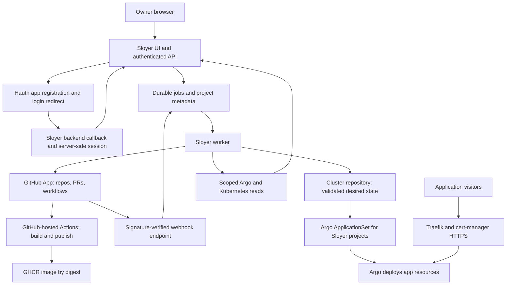

# Sloyer: implementation plan

Status: approved by the owner with shared self-hosted PostgreSQL, 9 November 2026. Local app implementation and deployment configuration are being created; live installation remains a separate verified step.

Target URL: **https://sloyer.sigve.cloud**. Independent source repository: **SigveDev/sloyer**, checked out at **E:\Github\sloyer**. Infrastructure remains in **SigveDev/cluster**. This document is the implementation backlog, not a claim that features already exist.

Authentication dependency: **Hauth at https://hauth.sigve.cloud**, through a confidential app registration and hosted OIDC login redirect. See the [Hauth plan](HAUTH-PLAN.md) and [database strategy](DATABASE-STRATEGY.md). These decisions supersede the original deferred identity integration and SQLite-first storage recommendation.

## 1. Product goal

Sloyer is the deployment dashboard for sigve.cloud. Select a GitHub repository, configure how it builds, select a hostname, and deploy it without editing Kubernetes YAML, copying image digests, registering an Argo Application by hand, or signing in to the VPS for each application.

Keep the learning value: every deployment exposes its source commit, Actions run, image digest, cluster commit, Argo Application, Kubernetes health, and certificate status. An expandable “Under the hood” panel explains the resources Sloyer generated.

This is a personal application platform with a Vercel-inspired workflow. It runs ordinary containers on the existing VPS; global edge hosting, serverless functions, automatic high availability, and Vercel's entire product catalog are outside the initial scope. The existing Get started guide remains useful as the manual path and troubleshooting reference.

## 2. Existing foundation and actual gaps

The repository configuration reviewed for this plan contains:

- Ubuntu 26.04 on a single Hostinger VPS, approximately 2 vCPU, 8 GB RAM, and 96 GB root storage, as previously reported.
- K3s with containerd, Traefik, cert-manager, Argo CD, and Headlamp.
- `SigveDev/cluster` as the GitOps repository; applications in `apps/<name>`, registration manifests in `argocd/apps`, and shared network rules in `networking/launchpad`.
- An Argo `launchpad` AppProject limited to the `launchpad` namespace and Deployment, Service, Ingress, NetworkPolicy, and Certificate resources. It does not currently allow database resources, ConfigMaps, or sealed secrets.
- A generic `Promote app` workflow that checks a registered GHCR image and updates its immutable digest. It currently rejects a run if `main` changed during verification, so concurrent onboarding and releases need a retry/rebase design.
- Vite + TypeScript template build/deployment helpers, with private and public package options.
- Default-deny ingress and egress in `launchpad`, with explicit DNS, ingress, and certificate-validation allowances.

There is no inspected ApplicationSet/root app watching the registration directory. Merely committing a new Application file does not currently register it. There is also no inspected deployment API, durable job queue, secret-management UI, database provisioning service, or historical log store. Live versions, capacity, DNS, existing secrets, and backups must be verified during implementation; local files do not prove live readiness.

## 3. Intended user experience

1. Open Sloyer. Its backend redirects an unsigned-in visitor to Hauth's hosted login; after authentication and assignment checks, Hauth returns to Sloyer's registered callback and Sloyer creates its own application session.
2. Select **New project**, then choose a repository from the repositories granted to the Sloyer GitHub integration. Repository visibility and container-package visibility are separate choices.
3. Sloyer detects a Vite/static project or a Dockerfile. Select branch, monorepo root, build settings, output directory or container port, and health-check path.
4. Choose an unused hostname, initially `<project>.sigve.cloud`. Add environment variables and optional runtime secrets. Choose a resource preset.
5. Review the proposed workflow changes and generated cloud configuration. Sloyer opens an onboarding PR in the source repository when files are missing. The owner merges it in GitHub; an eventual auto-merge option is explicit and opt-in.
6. Click **Deploy** after onboarding is ready. Sloyer dispatches the build and shows build output, publication, promotion, Argo reconciliation, rollout, and HTTPS readiness as separate stages.
7. Once healthy, open the site. Pushes to the production branch trigger subsequent deployments automatically if enabled.
8. View deployment history, live runtime logs, project configuration, domains, secrets, resource usage, and related databases in Sloyer. Redeploy, roll back, pause, or delete through the dashboard with appropriate confirmation.

Any incomplete prerequisite is displayed as an actionable setup check. A successful Actions job alone must never produce a false “Live” status.

## 4. Architecture and technology

Recommended starting point: one TypeScript monorepo with a **Vite + React frontend**, **Fastify API**, shared request schemas, and a durable worker. Choose compatible stable versions when implementation starts and commit lockfiles. React is a recommendation for the richer dashboard, not a requirement inherited from the existing plain Vite guide.



Builds stay on GitHub-hosted runners. Do not add a Docker daemon, privileged build Pod, or repository-code execution to the VPS. Sloyer's API serves the built frontend from the same origin; Traefik remains the ingress. A separate host Nginx installation is unnecessary.

Use **one self-hosted PostgreSQL instance on the VPS**, for Sloyer's projects, durable jobs, application sessions, and audit metadata. Hauth has a separate database and restricted login role on the same instance; Sloyer cannot read the identity store. Use transactional job claims/leases, migrations, bounded connection pools, and independently tested recovery. See the [database strategy](DATABASE-STRATEGY.md) for StatefulSet deployment, role isolation, capacity, backups, and recovery. This replaces the earlier SQLite-first proposal. Customer database provisioning is separate from both services' metadata stores.

Expose job updates and live logs through server-sent events with reconnect cursors, bounded buffers, and cancellation. Use provider adapters for GitHub, GitOps, runtime inspection, secrets, and databases so the HTTP handlers do not become shell-command wrappers.

## 5. Hauth app registration and login

Use **Hauth** as Sloyer's production OpenID Connect provider. Its issuer is `https://hauth.sigve.cloud`. Sloyer is a confidential web application with a backend-for-frontend; its browser bundle is not an OAuth confidential client. Implement Authorization Code + PKCE S256 through a maintained OIDC client library, using discovery rather than hard-coded token endpoints.

Register **Sloyer production** in Hauth with:

| Setting | Value |
| --- | --- |
| Client ID | Issued by Hauth; stored as backend configuration |
| Client credential | Protected backend Secret; never a Vite variable |
| Redirect URI | `https://sloyer.sigve.cloud/auth/callback` — exact match |
| Post-logout URI | `https://sloyer.sigve.cloud/` — exact registered destination |
| Flow | Authorization Code with mandatory PKCE S256 and confidential-client authentication |
| Initial scopes | `openid profile email`; add refresh/offline permission only if required |
| User assignment | Required; invite/login alone grants no access |
| App roles | `sloyer.viewer`, `sloyer.deployer`, `sloyer.admin` |

Maintain separate development and staging registrations with exact callback URLs/ports, not a wildcard redirect. Sloyer's `/auth/login` saves short-lived state, nonce, and PKCE verifier server-side and redirects to Hauth. The callback validates these values, exchanges the code over HTTPS, verifies issuer/audience/signature/expiry, and maps `(iss, sub)` to a Sloyer user. Passwords and MFA entry exist only on Hauth's hosted account pages.

Create an opaque server-side Sloyer session in its own PostgreSQL store, using a host-only Secure, HttpOnly cookie and appropriate SameSite policy. Never store tokens in localStorage or share a `.sigve.cloud` session cookie. Enforce session, project access, app role, and CSRF/origin checks on every sensitive API request, including logs and event streams. A viewer does not receive deployment or log access merely because login succeeded; log access is separately authorized.

Hauth supplies identity and coarse roles; Sloyer owns project membership and permission checks. Enforce an initially five-minute maximum assignment-revalidation window, with fail-closed privileged mutations when fresh authorization cannot be established. Define how queued deployment jobs react to assignment revocation; background workers use service credentials rather than indefinite user tokens. API scopes for a future CLI are separate from app roles and require explicit resource-audience validation.

Logout clears Sloyer's session and optionally performs Hauth RP-initiated logout to its registered destination. Clearing a local cookie does not guarantee logout from every application. The detailed token, assignment, revocation, and recovery contracts are in the [Hauth plan](HAUTH-PLAN.md).

Until Hauth's owner login, MFA, assignment, and Sloyer callback are tested, keep development and any prototype management API restricted to localhost or an enforced VPN/IP allowlist. This is a development boundary, not an alternate public login or a production auth bypass. Keep administrator access restricted as an additional layer where practical after OIDC is enabled. Public management launch requires working Hauth authentication and backend authorization.

The GitHub webhook endpoint is separate from browser login and validates its raw-body HMAC signature, installation/repository identity, event type, body size, and delivery ID before queueing work. It cannot be protected by a browser login redirect. Duplicate deliveries are harmless and responses return promptly.

GitHub App installation is a repository integration, independent of Hauth login. Keep Argo and Headlamp's existing authentication enabled. Bootstrap and repair Hauth through the independent GitHub/Argo administrator path so Sloyer login is not required to recover its own identity provider.

## 6. GitHub integration and build workflows

Use GitHub Apps with short-lived installation tokens instead of distributing a new cross-repository PAT to every application.

Prefer separate installations/apps for source integration and cluster writes:

| Integration | Required capability | Boundary |
| --- | --- | --- |
| Source integration | Metadata read, Contents read, Actions write for dispatch/cancel; Actions read for runs/logs | Only owner-selected application repositories |
| Optional onboarding writer | Contents write, Pull requests write, and Workflows write when changing `.github/workflows` | Explicitly enabled for source repositories that need generated workflows; verify exact endpoint permissions during implementation |
| Cluster writer | Contents write; Pull requests write if using PR mode | Only `SigveDev/cluster`; application callers cannot choose arbitrary files or branches |
| Build job `GITHUB_TOKEN` | Contents read, Packages write; other scopes only when required | The source repository's trusted publishing job |
| Promotion verifier | Packages read plus explicit package access | Cluster workflow identity, or a dedicated verifier with actual GHCR access |

GitHub App repository credentials are not automatically GHCR pull credentials. Retain the supported classic PAT read-package mechanism for node pulls until an alternative is verified. Keep keys/tokens server-side, encrypted and rotatable; never place them in the Vite bundle or browser storage.

Standardize a versioned source workflow based on the existing template:

- PRs run checks and smoke tests without publishing production releases or receiving production secrets. Fork PRs do not receive private deployment credentials.
- Trusted production-branch pushes and explicit dispatches run tests, build an OCI image on the GitHub runner, smoke-test it, publish to GHCR, and produce release metadata containing repository ID, source SHA, run ID, image name, and immutable digest.
- Pin third-party actions to verified commit SHAs. Support a repository root setting and bounded build configuration; never interpolate untrusted names into shell scripts.
- Start with Vite/static and existing Dockerfiles. Add Node services/workers next. A static preset can supply a reviewed multi-stage Dockerfile rather than requiring a handwritten one.
- Do not replace a repository's unrelated existing workflows. Onboarding changes are visible in a PR and re-runnable without duplication.
- Sloyer verifies the completed run belongs to the selected installed repository, trusted workflow/ref, expected source commit, and expected image. A browser-supplied digest or arbitrary callback URL is not a trusted release.
- Download structured release metadata through GitHub APIs and inspect the image with an authorized identity. A webhook triggers verification; it does not by itself authorize promotion.
- Manual build cancellation and retry are scoped to the selected project's run. Actions concurrency prevents obsolete builds promoting over newer desired deployments.

Public repositories and public packages must work without registry pull secrets. Private packages require two independent checks: the promotion verifier can read them, and the target namespace has a valid image-pull Secret. Granting cluster Actions Read access does not create the latter.

For private onboarding, discover whether GitHub exposes an applicable package-access API for the actual account and integration. Do not promise automatic Manage Actions access configuration without proving it. If it cannot be automated, show a one-time GitHub package-settings action and recheck afterward, or use a separately authorized verifier. This still requires no VPS login. Publishing a package must never silently change its visibility.

## 7. GitOps and automatic Argo registration

Introduce a **dedicated ApplicationSet** for Sloyer-managed projects. Its Git file generator watches validated descriptors under a new path, leaving existing manually registered apps alone. The generator uses a fixed AppProject, repository, destination namespace, and template; project descriptors cannot select arbitrary privileges.

Proposed additional cluster layout:

```text
cluster/
  platform/sloyer/                     # UI/API deployment, RBAC, Hauth/DB config, ingress
  platform/hauth/                      # Administrator-owned identity platform; not an app-generated path
  platform/sealed-secrets/             # Controller configuration and recovery documentation
  argocd/sloyer-applicationset.yaml    # Fixed template; discovery of new projects
  sloyer/projects/<project-id>/
    project.json                      # Validated non-secret descriptor and desired revision
    manifests/
      kustomization.yaml
      deployment.yaml
      service.yaml
      ingress.yaml
      certificate.yaml
      network-policy.yaml
      configmap.yaml                  # Non-sensitive runtime configuration
      sealed-secret.yaml              # Ciphertext only, when required
  sloyer/databases/<database-id>/      # Added in the database phase
```

Deploy Sloyer's control plane into a dedicated `sloyer` namespace. Initially deploy trusted owner workloads into existing `launchpad`; use distinct immutable project labels and resource names. Shared namespaces are **not** a tenant security boundary. Require isolated namespaces, quotas, narrowly scoped RBAC, and an administrator-owned namespace provisioning controller before enabling untrusted/multiple users.

Use a separate, administrator-owned Sloyer AppProject for workload resources in `launchpad`. Add only the kinds needed at each phase; do not broaden the existing project to cluster-admin. The ApplicationSet and platform definitions live outside application-generated paths. Sloyer must not be able to request a new AppProject, ClusterRole, arbitrary chart, or host mount from an imported repo.

Argo owns generated workload resources, including their network policies. Keep existing shared DNS/ACME infrastructure rules in the networking app. Avoid two Argo Applications owning the same resource. Enable automatic sync for generated apps; start with automatic pruning disabled and explicit deletion workflows. Removing a descriptor must not cascade-delete a database or volume.

Consolidate promotion into one validated manifest update service/command, extending the existing promotion checks. Serialize cluster writes globally or use optimistic concurrency with bounded retries and regeneration against current `main`. Per-project workflow concurrency alone cannot prevent cross-project Git conflicts. Preserve unrelated changes, use idempotency keys, and record source/run/digest/cluster commit together. Use the GitHub App identity for commits/PRs and verify validation is triggered; do not assume commits made by `GITHUB_TOKEN` trigger downstream workflows.

Rollback writes a previously verified immutable digest to Git as a new desired revision. Do not depend on an imperative Argo rollback or `kubectl rollout undo` that auto-sync would overwrite. Application rollback does not roll back a database schema migration.

## 8. Deployment lifecycle, reliability, and logs

Durable state machine:

`queued → preflight → building → publishing → verified → committing → reconciling → rolling-out → checking-domain → live`

Every stage can produce an actionable failed state; also support canceled, superseded, paused, and degraded. A deployment records timestamps, retries, actor, source SHA, image digest, workflow/run IDs, cluster commit, observed Argo revision, rollout state, and certificate/DNS checks.

- Persist intent before external calls. Dispatches, commits, webhook handling, and resource generation must be idempotent across process restarts.
- Correlate one build run to one deployment; handle out-of-order events and the case where a commit succeeds but the response is lost.
- Treat Argo refresh as optional acceleration. Poll observed state with backoff as recovery when events are missed. Distinguish desired, building, and currently serving revisions.
- “Live” requires the desired revision to reconcile, workloads to be available, endpoint checks to succeed, and DNS/TLS to be correct. Domain validation uses fixed expected addresses and bounded outbound requests to avoid SSRF.
- Show a last-known timestamp and connection error when providers cannot be reached; do not display stale green status as a fresh result.

The logs screen separates:

| Stream | Initial source | Limitations |
| --- | --- | --- |
| Build output | GitHub Actions run/jobs and authorized log downloads | Show GitHub's live run link while a job is active; do not promise a supported line-by-line live API before verifying it |
| Deployment activity | Sloyer job history, Argo status, Kubernetes Events | Durable Sloyer timeline; Events themselves expire |
| Runtime output | Kubernetes `pods/log`, including previous container when available | Tail/follow, timestamps, container selector, bounded lines; lost on rotation/deletion without aggregation |
| Audit events | Sloyer append-only activity records | Actor, action, target, result; no secret values |

Add search and filtering to fetched logs, download limits, and clean terminal escape sequences. Server-side authorization checks every log request. Mask configured secret values where possible, but warn in secret setup that application output can still leak transformed secrets. Do not present masking as a guarantee.

Add persistent runtime log aggregation only after measuring VPS headroom. A bounded external log service or carefully budgeted Loki installation is a later option; retention, disk cap, and expiration must be configured before enabling it. Initial historical build retention follows GitHub's configured retention.

## 9. Environment variables and secrets

Separate public build-time values, private build secrets, non-sensitive runtime configuration, and runtime secrets in the UI. For Vite, `VITE_*` values are embedded in downloaded JavaScript and are public. Changing those values requires rebuilding; restarting a static Nginx container will not change its bundle.

For GitOps runtime secrets, propose **Sealed Secrets**: the backend encrypts submitted values using the cluster controller's public certificate, commits only the sealed object, and the controller creates the namespace/name-bound Kubernetes Secret. The application references it through `secretKeyRef` or `envFrom`. API responses list secret names and status only; replacing a secret is possible, reading the original plaintext back is not a product feature.

The sealing public key is not a secret. Its authenticity and namespace/name binding must be verified. Keep the controller's private recovery keys backed up securely outside the VPS; without those, sealed files alone are not disaster recovery. Verify K3s Secret encryption at rest remains enabled and understand that sealed secrets do not protect against a compromised cluster administrator or workload that legitimately receives the plaintext.

Store initial GitHub App credentials, webhook verification material, backup credentials, and node registry credentials through the administrator bootstrap process; never commit them in plaintext. Sloyer must not be able to retrieve the sealing private key or broad existing cluster secrets.

For private package onboarding, seal a package-reader credential into the target namespace and reference its image-pull Secret. Provide expiration reminders and replacement before revocation. Keep this credential separate from runtime environment variables; workloads must not receive a mounted registry token.

Private build secrets are a later explicit capability: store through GitHub Actions secret APIs and use Docker BuildKit secret mounts, not build arguments or `VITE_*`. Reject “secret build variable” configurations that would intentionally bake secrets into the final frontend image. Workflow access and trusted branch policy govern who can run jobs with secrets.

## 10. Domains and URLs

- Default hostname: `<project>.sigve.cloud`, with a validated, available slug. Reserve `sloyer`, `argo`, `cluster`, `hello`, `get-started`, existing app hosts, and operational names.
- A working wildcard DNS A record can cover new direct subdomains. Verify authoritative DNS and the absence of conflicting records; do not assume the earlier wildcard configuration is still correct.
- Generate an Ingress and individual cert-manager Certificate for every hostname, reusing Traefik and `letsencrypt-prod`. Wildcard DNS does not imply a wildcard certificate. Port 80 must continue to support HTTP-01 validation.
- A domain settings screen supports add, verify, select primary, redirect, and remove. Keep the current domain serving while a replacement passes checks; certificate/DNS failures do not prematurely remove the healthy route.
- External custom domains come after the default-subdomain MVP. Require ownership proof, DNS instructions, collision checks, and certificate readiness before routing. Do not permit arbitrary host takeover through a text field.
- Future preview hostnames use `<project>-pr-123.sigve.cloud`, avoiding a new nested DNS wildcard requirement. Add quotas, expiry, and trusted-code rules before automatic previews.
- Validate and rate-limit domain operations to avoid unnecessary ACME requests and certificate issuance limits.

## 11. Databases and persistent data

Provide a **Databases** section with create, status, connection details, authorized project attachment, backup status, restore, and protected delete. Start with **PostgreSQL only**; add Redis/Valkey and other engines after the PostgreSQL lifecycle is reliable.

Use the **single shared PostgreSQL StatefulSet** in the dedicated `data` namespace for Hauth, Sloyer, and future application databases. Each service gets its own database and restricted login role, for example `hauth`/`hauth_app` and `sloyer`/`sloyer_app`. Sloyer and ordinary apps receive neither the PostgreSQL superuser nor `CREATEDB`/`CREATEROLE`. All services share this instance's CPU, memory, storage, downtime, and recovery boundary.

Deploy one PostgreSQL pod with a persistent volume, ClusterIP-only service, explicit storage/resource limits, SCRAM password authentication, and network policy allowing only approved service pods. No public PostgreSQL port, NodePort, or managed database provider is required. This is a single-server setup, not HA. See [database strategy](DATABASE-STRATEGY.md).

Application database provisioning is performed by a separate constrained administrator-approved process that creates an approved database/role, revokes public CONNECT access, and attaches a protected connection Secret to the selected app. Do not give general Sloyer API handlers or application pods broad database-administration credentials. Start with the `hauth` and `sloyer` databases created during bootstrap; expose self-service database creation only after validating the provisioning boundary.

- Revoke PUBLIC CONNECT on application databases and privileges on their public schemas. One application role must not connect to or inspect another service's database. Separate migration-owner and runtime roles where practical.
- Set small per-service connection pools, database/role connection limits, PostgreSQL memory settings, resource requests/limits, and disk alerts. Resource contention remains shared despite role isolation.
- Store credentials only in protected namespace-local Kubernetes Secrets, never Git or browser assets. Keep registry, identity signing keys, database superuser credentials, and application database passwords separate.
- PostgreSQL data is on a retained persistent volume; never put it in `emptyDir`. Volume deletion and service/database deletion are separate destructive actions. PostgreSQL major-version upgrades require a planned migration, not a casual image tag change.
- Schedule encrypted database and role backups to storage outside the VPS. Initial logical backups provide recovery to the last successful dump; continuous WAL/PITR is a later separate capability. A backup file on the same disk alone is not sufficient.
- Restore into a fresh test instance/database and validate application access before switching production references. Database rollback is separate from application image rollback.
- Reserve Hauth and Sloyer databases from ordinary project deletion. Run schema migrations explicitly and do not reverse them automatically on app rollback.

Database creation stays unavailable until backup and restore acceptance tests pass. The UI should say why, rather than offer a misleading “production-ready” database button.

## 12. Dashboard pages and feature priorities

| Page | First usable version | Later additions |
| --- | --- | --- |
| Overview | Project health, active releases, failures, recent activity, cluster capacity summary | Notifications, richer usage trends |
| Import project | Installed GitHub repo search, presets, branch/root/domain/resources, setup checks | More frameworks and monorepo integrations |
| Project | Live URL, serving revision, deployment action, auto-deploy setting | Multiple production regions only on expanded infrastructure |
| Deployments | Stage timeline, run/digest/commit links, retry/cancel, Git rollback | Preview environments, promotion approvals |
| Logs | Build links/downloads, deployment events, runtime tail/follow | Persistent runtime retention/search |
| Environment | Runtime variables, write-only runtime secrets, explicit Vite public-build values | Scoped build secrets and preview overrides |
| Domains | Default sigve.cloud hostname, DNS/TLS status | Verified external domains, aliases/redirects |
| Databases | Delivered in a separate phase | Additional engines, advanced restore operations |
| Settings | Hauth account/role status, GitHub connection health, resource presets, backup/credential warnings | Teams and richer project-role administration |

Use a readable dashboard up to 1600px wide with responsive navigation and useful empty/error/loading states. Show the real backend state; a UI prototype must label simulated actions. Prefer clear progress and remediation over a page of raw Kubernetes YAML, while keeping the underlying details available.

Other useful later features: CronJobs, background workers, persistent application storage, webhooks/notifications, deploy protection, health alerts, usage caps, and preview cleanup. CDN/WAF, billing, edge/serverless runtimes, arbitrary plugins, database branching, and a public multi-tenant marketplace are not MVP commitments.

## 13. Capacity, access, and deletion boundaries

The original VPS is suitable for a small personal platform, subject to actual measurements. Before installing anything, inspect CPU/memory/storage usage and existing workloads. Begin with small API/UI budgets and no in-cluster build system, Redis queue, or observability stack. Set requests/limits and leave measured room for Kubernetes, Argo, databases, and workload spikes; reject deployment requests when configured capacity is exhausted.

Use resource presets, object-size limits, API rate limits, build/deploy timeouts, and project quotas. Limit log retention and image/cache growth. Keep application service-account token mounting disabled by default, containers unprivileged, and persistent storage opt-in.

Backend Kubernetes access is read-only and namespace-scoped for the required Deployments/Pods/Events/Services/Ingresses/Certificates and `pods/log`. It cannot execute in Pods, proxy arbitrary services, create RBAC, or list all Secrets. All workload writes go through validated Git configuration, except explicitly designed database/secret provisioning with a separate narrow identity. Restrict Argo tokens to relevant applications; no cluster-admin kubeconfig in Sloyer.

Give the `sloyer` namespace default-deny policies and explicit access to DNS, the required Kubernetes/Argo endpoints, and external GitHub/GHCR/backup services and internal PostgreSQL. Standard Kubernetes NetworkPolicy does not accept hostname allowlists; choose a documented HTTPS egress proxy, maintained destination ranges, or a deliberate bounded egress policy rather than generating fictitious FQDN rules. Application egress is a separate project setting: existing static sites need little beyond DNS, but backend apps require explicit database/API connectivity. Network policy is not authorization for Sloyer's HTTP API.

Because GitHub Contents write is repository-scoped rather than directory-scoped, code validation alone is not a credential-level path restriction. Protect `cluster` platform/control-plane paths with reviews and branch rules, prefer a validated promotion PR/workflow gateway, and eventually split generated deployment state into a dedicated repository if the trust boundary expands.

Stopping an app preserves its project and data. Deleting an app, removing a domain, deleting a database, and destroying a volume are separate actions. The dashboard shows the exact resources and retention choices before confirmation. Sloyer must not be able to delete or overwrite its own platform resources through a normal project request.

## 14. Implementation phases and completion checks

### Phase 0 — Contracts and access prerequisites

Verify live cluster capacity, namespaces, wildcard DNS, ingress/certificates, image pull configuration, Argo ApplicationSet controller availability, and backups. Decide the private administrator access method. Register selected-repository GitHub integration(s), verify workflow and package permissions, define versioned project/release schemas, and document bootstrap rollback.

In parallel, complete Hauth's protocol/owner-login prerequisites through its independent deployment path, create Sloyer's confidential registration and owner assignment, and bootstrap the single PostgreSQL StatefulSet with separate Hauth/Sloyer databases and credentials. Hauth and Sloyer development can proceed in parallel, but public management launch depends on Hauth integration acceptance.

Deliverable: a tested integration checklist and approved resource/permission map. No anonymous public deployment endpoint. Existing applications remain untouched.

### Phase 1 — Real dashboard foundation

Create the independent Sloyer repository with frontend, API, shared schemas, PostgreSQL migrations, durable jobs, mock adapters for local development, tests, Docker build workflow, and developer README. Add health/readiness endpoints, Hauth discovery/login/callback/logout, protected backend sessions, role checks, and connection diagnostics. Bootstrap Sloyer itself through existing GitHub/Argo tools in its dedicated namespace, keeping ingress restricted until Hauth integration passes.

Deliverable: assigned owner logs in through Hauth and sees real connected repositories and application/deployment status; unassigned users and unauthorized API operations are denied. Simulation mode is clearly labeled. API/client/database secrets never appear in browser assets.

### Phase 2 — End-to-end application deployment MVP

Implement onboarding PRs, static/Dockerfile presets, public/private package checks, sealed runtime secrets and registry credential setup, hostname/resource validation, GitHub dispatch, structured release verification, serialized GitOps writes, and ApplicationSet discovery. Implement timeline, runtime logs, retry/cancel, redeploy, Git rollback, and production-branch auto-deploy.

Deliverable: import a new public Vite repository and a private Dockerfile repository, deploy both to unused subdomains, push changes, and see the new serving revision without touching YAML or a VPS terminal. No manual Argo app registration or digest copying. A private-package permission gap is explicit and never disguised as a successful deployment.

### Phase 3 — Operations and developer experience

Add domain changes, verified external domains, variable rotation, project suspension/deletion, deployment notifications, resource summaries, persistent audit history, backup recovery for Sloyer, and failure/reconciliation tooling. Add persistent runtime logs only if a measured retention budget fits.

Deliverable: recover from a worker restart, missed webhook, Git race, failed build, bad pull credential, unhealthy rollout, and failed certificate issuance without duplicate releases or lost desired state.

### Phase 4 — Databases

Implement a constrained database/role provisioning process on the shared PostgreSQL instance, protected secret attachment, resource/connection limits, protected deletion, and restore workflows. Reserve Hauth/Sloyer databases from ordinary application lifecycle operations. No managed provider or database operator is required for the initial single instance.

Deliverable: create a database from Sloyer, deploy a test app that uses it, restore an off-node backup into a fresh database, and prove application/volume deletion cannot accidentally destroy retained data.

### Phase 5 — Previews and expanded access

Add same-repository trusted PR previews, flat preview hostnames, resource/lifetime limits, cleanup and isolated configuration. Never auto-run fork code with production secrets. Hauth login is already required from Phase 1; expand project membership/roles and introduce isolated namespaces before inviting other users. New applications may opt into their own Hauth registrations later without sharing Sloyer's client credential.

Deliverable: a preview cannot read production credentials, and authenticated users cannot view or change projects outside their permissions. Public management access remains blocked until this boundary is verified.

## 15. Test strategy and definition of done

- Unit-test schemas, resource generation, safe path/hostname handling, release provenance, state transitions, idempotency, and secret redaction boundaries.
- Integration-test against a disposable local K3s/k3d cluster and test GitHub repositories/packages. Simulate replayed/out-of-order webhooks, stale Git revisions, process restarts, exhausted storage, provider rate limits, and partial failures.
- Test public and private repositories/packages independently. Force a fresh image pull so cached images do not hide broken credentials.
- Browser-test the complete import/deploy/logs/domain/secret/retry/rollback flow and responsive accessibility. Use real integration fixtures for critical deploy paths; do not equate mocked success with a live deploy.
- Security-test management access from an untrusted network, webhook signature failures, cross-project access, secret leakage in API responses/assets/logs, arbitrary URL requests, and imported configuration attempting elevated privileges.
- Test the database restore and Sloyer metadata/secret-controller recovery procedures before claiming recoverability.
- Test the Hauth redirect/callback, wrong issuer/audience, state/nonce/PKCE errors, unassigned user, insufficient role, assignment revocation, session logout, and identity-provider outage. Confirm no public bypass exists and that Hauth recovery works without Sloyer.

The first release is done when an owner signs in through the assigned Hauth registration and can deploy and update a supported app through Sloyer alone after the one-time platform/GitHub bootstrap, see accurate logs/status, choose its sigve.cloud URL, manage runtime secrets, and roll back through Git. Sloyer/Hauth shared-instance PostgreSQL storage is an initial dependency; customer database provisioning is a separately accepted milestone. Existing manual GitHub/Argo workflows continue to function as a recovery path.

## 16. One-time setup versus everyday use

One-time administrator work includes Hauth bootstrap/MFA/Sloyer registration and assignment, shared PostgreSQL instance with isolated databases/roles, Sloyer's namespace/RBAC/ingress, ApplicationSet/AppProject, sealing controller and recovery keys, GitHub App credentials/webhook, registry credential bootstrap, and off-node backups. The shared StatefulSet is part of the initial platform bootstrap. This is genuine platform work; it cannot be removed just by making a dashboard.

After that, normal supported application onboarding, deployment, status checks, logs, domain selection, and secret replacement happen through Sloyer and GitHub. No routine SSH/VPS access is required. Exceptional node recovery or changing cluster-wide privileges remains administrator work. GitHub workflow PRs still require the configured approval policy, and private package permissions may require a one-time GitHub settings action if no supported automation exists.

## 17. Documentation and sources

When implemented, update the Get started guide to make Sloyer the primary path, retain a manual GitHub/Argo chapter, version the template workflow contract, and add `cluster/docs/SLOYER-OPERATIONS.md` for setup, permissions, recovery, and upgrades. Do not describe planned phases as shipped functionality.

Use [Hauth's registration and integration contract](HAUTH-PLAN.md) for login and [the database strategy](DATABASE-STRATEGY.md) for the approved shared PostgreSQL setup. Neither plan implies these services have already been deployed.

Official references reviewed while preparing this plan (9 November 2026); verify current compatibility during implementation:

- [Vercel deployments](https://vercel.com/docs/deployments), [logs](https://vercel.com/docs/logs), and [environment variables](https://vercel.com/docs/environment-variables): product workflow references, not a promise of identical infrastructure or features.
- [GitHub App permissions](https://docs.github.com/en/apps/creating-github-apps/registering-a-github-app/choosing-permissions-for-a-github-app) and [installation tokens in Actions](https://docs.github.com/en/apps/creating-github-apps/authenticating-with-a-github-app/making-authenticated-api-requests-with-a-github-app-in-a-github-actions-workflow).
- [GitHub webhook validation](https://docs.github.com/en/webhooks/using-webhooks/validating-webhook-deliveries).
- [GHCR authentication](https://docs.github.com/en/packages/working-with-a-github-packages-registry/working-with-the-container-registry): package/node access is separate from repository access.
- [Argo Git generators](https://argo-cd.readthedocs.io/en/stable/operator-manual/applicationset/Generators-Git/) and [automated sync](https://argo-cd.readthedocs.io/en/stable/user-guide/auto_sync/): discovery and desired-state deployment.
- [Kubernetes Secret practices](https://kubernetes.io/docs/concepts/security/secrets-good-practices/).
- [Sealed Secrets](https://github.com/bitnami/sealed-secrets): encryption scopes, controller setup, key backup, and recovery.
- [CloudNativePG backup documentation](https://github.com/cloudnative-pg/cloudnative-pg/blob/main/docs/src/backup.md) and [recovery documentation](https://github.com/cloudnative-pg/cloudnative-pg/blob/main/docs/src/recovery.md): operator/backup integration selection must match the pinned stable version.
